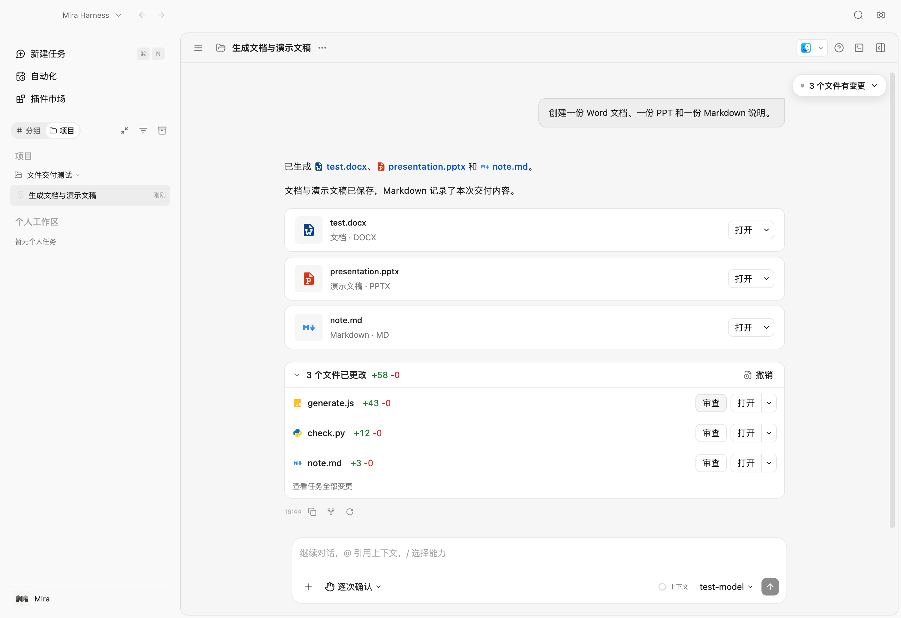
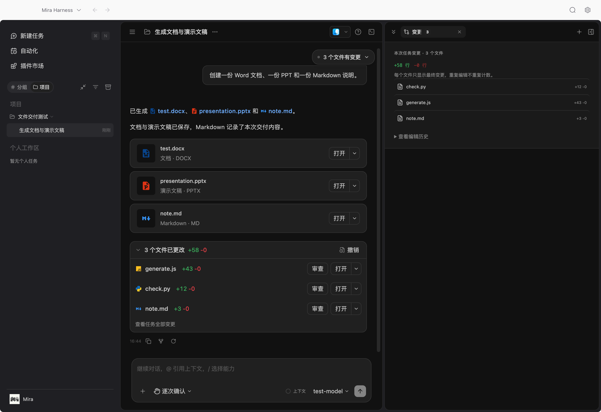

# 对话文件交付展示

2026-10-15，桌面 Electron 范围。未提交或推送，保留工作区原有改动。

## 对齐来源与最终行为

参考本机 ZCode `packages/ui/src/AssistantPreviewCards.tsx`、`lib/assistantFileReferences.ts`、`v4/ConversationFileSummaryPanel.tsx` 和 `OpenSplitButton.tsx`。

- 正文文件链接带类型图标和蓝色文字，流式与完成态共用现有授权打开路径。
- 成品卡识别 Markdown、HTML、DOCX、XLSX、PPTX、PDF 及支持的音视频类型。按回复引用顺序展示、去重并通过工作区文件列表验证；代码围栏示例、缺失文件、外部链接和越界路径不显示为成品。
- 卡片与变更行提供打开分体按钮、系统应用菜单、文件管理器显示及复制绝对/相对路径，失败在原位置显示。
- 回复变更条默认折叠。展开后按文件唯一列出，提供审查、打开，以及任务全部变更入口。最新回复复用已有文件恢复预览作为撤销入口，确认后才应用恢复。
- 宿主保存每轮首次修改前至最终修改后的净差异，完成回复携带摘要；同一文件反复编辑不累计中间差异，恢复原内容后排除。旧记录缺少快照时保留文件信息，不伪造净行数。排除其他运行与继承历史。
- 任务面板默认只显示最终文件汇总；逐次编辑留在“查看编辑历史”中，默认折叠，查找选中操作时仍可展开定位。

## 主要改动位置

`MiraDeliverableFiles.tsx`、`MiraFileOpenButton.tsx`、`MiraReplyChanges.tsx`、`MiraConversationMessages.tsx`、`markdown.tsx`、`MiraFileRewindPreview.tsx`、`message-parts.tsx`、`MiraTaskChangesPanel.tsx`；对应 `mira-deliverable-files.ts`、`mira-reply-changes.ts`、`thread.css`、`harnessStore.ts` 与公开类型 `harness.ts`。

## 验证

- `npx tsc -p apps/harness-react/tsconfig.json --noEmit` 通过。
- `npm run harness:build`、`npx electron-vite build` 通过；构建保留已有依赖、包体积和 CSS highlight 优化器警告。
- 8 个相关测试文件共 194 项通过：`miraTaskChanges`、`harnessStore`、`harnessReactDeliverables`、`harnessReactTaskChanges`、`harnessReactMessageLinks`、`harnessReactFileRewindPreview`、`miraFileRewind`、`harnessRuntimeMessagePersistence`。覆盖真实写入快照、重复编辑、跨轮隔离、恢复、脱敏、持久化、文档发现与 DOM 展开。
- 隔离 macOS Electron 正式入口使用临时 HOME/SQLite 和文件夹，真实加载构建产物与宿主 IPC。3 个成品卡、3 个正文类型图标、3 个去重文件行、最终净行数、默认折叠、审查最终差异、系统应用/复制菜单、任务历史默认折叠和浅深色排版均检查。最终功能检查 12 项通过，含真实 Tab 焦点指示，无未捕获渲染错误；结果见 `assets/mira-conversation-output-2026-10-15/electron-report.json`。Office 文件使用占位测试数据，本次未验证 Office 文档内容渲染。
- 样式检测只提示 `thread.css` 既有规则，新增目标无报告项。项目全局清除 outline，本次按钮采用局部 inset 焦点指示。
- 未进行真实远端模型生成、外部应用实际启动、Windows 或安装包验收。未修改模型的自然语言总结内容；本次统一的是对话文件链接、成品和变更的产品展示。

