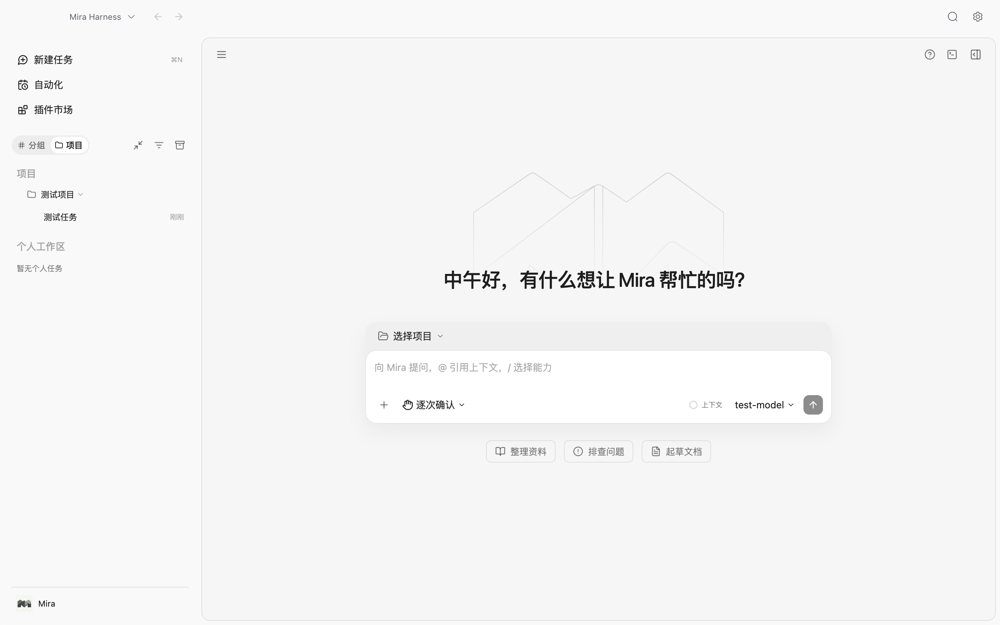
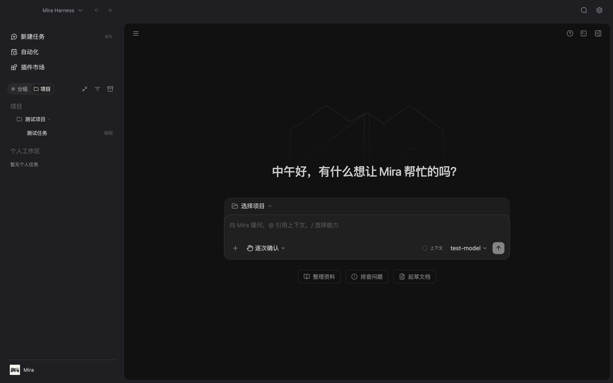
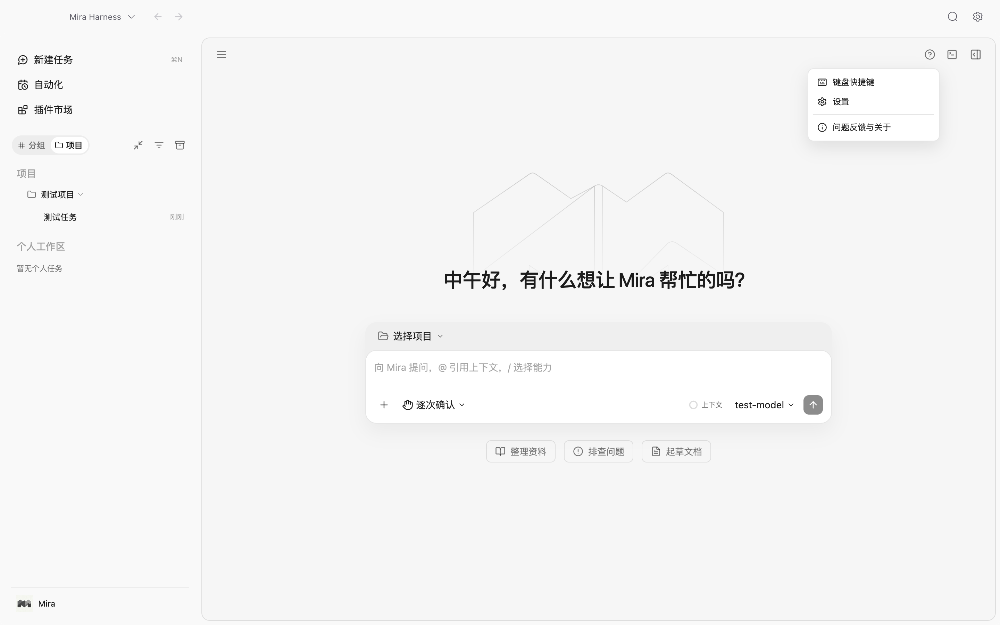
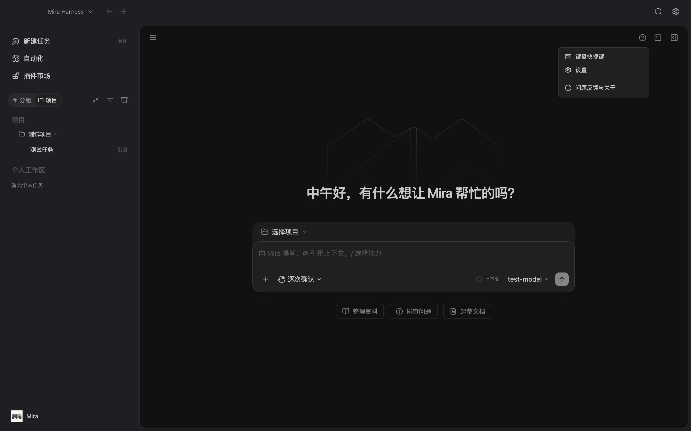

# Mira 桌面动画优化验证（2026-10-13）

本次按要求参考 ZCode 源码，统一工作台的动画节奏和浮层交互。欢迎背景保留已恢复的原版线框 Logo；三个主菜单「新建任务」「自动化」「插件市场」继续不显示悬浮提示。

## 行为与来源

参考 ZCode 提交 `aac4755666d09fdcd70272fcf063c077a639015f`，实际阅读 `packages/ui/src/components/ui/` 下 tooltip、dropdown-menu、context-menu、popover、hover-card、dialog、button、collapsible，以及 `app-shell/useAnimatedResizablePanel.ts`、`WorkspaceShellLayout.tsx`、`lib/documentHiddenMotionPause.ts`、`styles.css` 与 `v4/ConversationUserInputBody.tsx`。适配归因已补充至 `third-party-licenses/zcode/ADAPTATIONS.md`。

| 区域 | 结果 |
| --- | --- |
| 提示、菜单、子菜单、Popover、HoverCard | 150ms 入场、100ms 退出，淡入淡出、95% 缩放、4px 方向位移；退出期间禁止点击，Radix 在动画结束后卸载 |
| 弹窗与遮罩 | 180ms 入场、100ms 退出；使用独立 scale/translate，保留原来的定位 transform 和键盘焦点逻辑 |
| 按钮与侧栏细节 | 120ms 颜色/透明度反馈，150ms 图标位移；避免 transition-all |
| 侧栏 | 宽度一次提交，内容与阅读区通过 Web Animations 做短位移；打开 200ms、关闭 150ms，快速反向切换承接当前阅读区位置 |
| 工作区 | 保留上游有界 flex-grow 200ms 过渡和内容宽度冻结；transitionend 清理，240ms 兜底；拖动、窗口缩放和动态效果偏好变化立即结束 |
| Vue 桌面外壳 | 通用组件动画缩短为 180ms，快速反馈 120ms；Popover 与提示使用 150/100ms 淡入淡出及轻缩放，去掉回弹 |
| 减少动态效果 | 覆盖包含 BODY Portal 在内的 CSS 动画、过渡和滚动；侧栏与工作区立即提交最终状态 |
| 页面不可见 | 根据 visibilitychange 给文档打标记，禁用 CSS 动画，并结算有限 Web Animations；恢复可见移除标记 |

工作区尺寸过渡是本次保留的布局动画，限于显式切换且冻结昂贵内容的宽度。长用户消息原有的 max-height 折叠动画与上游一致，本次保持现状。没有扩展移动端布局或改动业务协议。

## 验证证据

- 9 个相关测试文件共 119 项通过：文档动画生命周期、面板尺寸/偏好、侧栏动画及快速反向切换、摘要、自动化、侧栏快捷键、模型菜单、用户消息、命令中心焦点。最后一次工作区清理顺序调整后重新通过全部 15 项面板测试，并覆盖最终尺寸应用时不保存受约束比例。
- React `tsc --noEmit`、Vue `vue-tsc --noEmit`、`npm run harness:build`、`npx electron-vite build` 与 `git diff --check` 通过。
- 独立测试 HOME、真实 Electron/IPC/SQLite、1440×900 桌面窗口中通过 69 项检查。模型地址为无服务的本地测试端口，没有发起模型任务或修改日常用户数据。
- 检查覆盖上下方向提示的入场/退出、延迟悬浮与快速重复、三个菜单无提示、项目菜单、任务右键菜单、模型菜单与子菜单、工作目录菜单、BODY Portal 命令中心居中/退出/焦点归还、侧栏逐帧宽度与位移、快速反向切换、工作区开关/键盘调整、原生窗口缩放，以及减少动态效果。
- 明暗主题的欢迎页与菜单截图各一张，已人工核对 Logo、浮层位置、内容和布局。

自动化启动的 macOS Electron 窗口在原生 hide/minimize 后仍返回 `document.visibilityState === 'visible'`。因此不可见策略采用显式 visibilitychange 注入验证：真实组件和 CSS 能禁用动画、关闭浮层并恢复；这四项检查不代表原生隐藏事件或后台 GC 的验收。Windows、安装包和 Vue 设置页每个弹窗未逐项运行验收。

证据文件：[Electron 检查结果](assets/mira-motion-2026-10-13/electron-result.json)、[检查脚本](assets/mira-motion-2026-10-13/electron-check.mjs) 与同目录测试/构建日志。脚本从仓库根目录运行，必要时用 `PLAYWRIGHT_MODULE` 指定 Playwright 模块路径；生成的报告和隔离数据放在临时目录。没有提交或推送代码。

